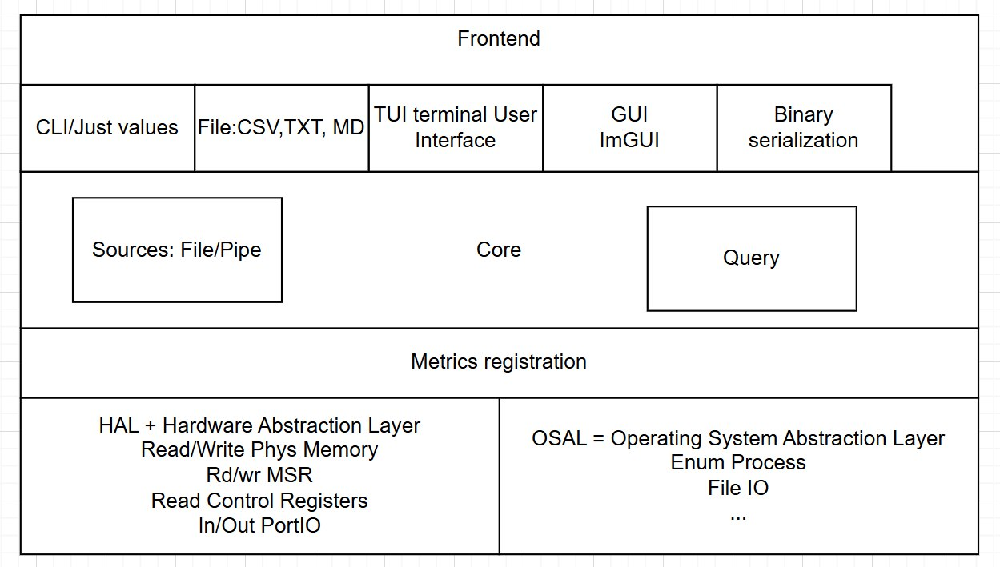

<p align="center"></p>

# Quanta

**Единая система сбора, обработки и отображения системных метрик на C.**

Quanta объединяет информацию об операционной системе и оборудовании в общий каталог:
стабильное имя метрики → provider → экземпляр с labels → измерение → query → frontend.
Сбор данных отделён от представления: один запрос можно использовать для консоли,
CSV/TXT-отчёта или интерактивного интерфейса.

**Версия 0.3.0 — архитектурный baseline на основе переданного `inv-0.2.2`.**
Это не завершённая реализация всего дизайн-документа. Linux проверен сборкой и тестами;
Windows-ветка сохранена и исправлена по исходникам, но нативный MSVC/WinAPI-прогон ещё нужен.
Опциональный GUI сохранён в исходниках; сборка GUI и открытие окна в этой поставке не проверены.

[Дизайн](docs/Quanta_Design.md) · [Архитектура](docs/ARCHITECTURE.md) ·
[Аудит и соответствие](docs/AUDIT.md) · [Сборка](docs/BUILD.md) ·
[Query](docs/QUERY.md) · [Тестирование](docs/TEST_REPORT.md) · [TODO](docs/TODO.md)

## Цель проекта

Получать системные метрики через один небольшой переносимый core, не привязывая пользовательские
интерфейсы к WinAPI, procfs, sysfs или конкретному устройству. Новые датчики добавляются через
provider и каталог, а новые форматы отображения — через sink событий. Для проверки core реальное
оборудование не требуется: в тестах используются независимые mock providers.

## Архитектура



Схема выше — исходная целевая архитектура, **не список уже реализованных возможностей**.
В частности, File/Pipe как источник сохранённых измерений, бинарная сериализация,
привилегированные MSR/PortIO/physical-memory операции ещё не реализованы.

```text
frontends/                  CLI, CSV/TXT/Markdown/value, TUI, optional GUI
        ↓ sink API
core/ + query/              catalog, provider contract, discovery, scheduler,
                            typed values, rate/delta, bounded history, live queue
        ↓ provider contract
sensors/ + metrics/         registration, semantic descriptors, extraction
        ↓ typed HAL context
hal/ + osal/                platform acquisition / time, files, threads, locks
```

## Что работает в baseline

- Статический `quanta_core` на C11; отдельные публичные и приватные заголовки, независимый каталог.
- Query v1: `select`, `optional`, labels/globs, `provider("id", metric)`, `rate`, `delta`,
  интервалы опроса, ограниченная история, layout и параметры отображения.
- Групповой опрос provider: несколько представлений одной метрики не создают независимые чтения.
  Есть явные статусы `WARMUP`, `NO_DATA`, `PERMISSION_DENIED`, `INVALID_DATA` и другие.
- Linux providers: OS, CPU accounting/utilization, память, network, DMI, hwmon, CPUID,
  корневая файловая система, собственный процесс. Фактическая доступность зависит от ОС и прав.
- Исполняемые файлы `quanta`, `quanta_cli`, `quanta_csv`, `quanta_txt`; TUI включён по умолчанию.
  GUI — опциональный C++/Dear ImGui frontend с программным растеризатором и XCB/Win32-окном.
- CTest запускается при обычной сборке; ошибка теста делает сборку неуспешной.
  Python добавляет интеграционные проверки, C-тесты не требуют Python.

Полный Linux x86-64 каталог содержит 52 дескриптора; минимальная сборка оставляет OS provider.
Это количество зарегистрированных метрик, а не гарантия наличия всех датчиков на компьютере.

## Быстрый старт: Linux

Из корня распакованного проекта, после установки CMake, Ninja, C-компилятора и Python 3:

```bash
cmake --preset linux-default
cmake --build --preset linux-default --parallel
ctest --preset linux-default --output-on-failure

./build/linux-default/bin/quanta --version
./build/linux-default/bin/quanta get os.name os.arch
./build/linux-default/bin/quanta examples/queries/01-inventory.q --redact
./build/linux-default/bin/quanta_csv get os.memory.total_bytes
./build/linux-default/bin/quanta get os.uptime --format value
```

`ctest` после build — удобный повторный запуск: по умолчанию тесты уже выполнены самой сборкой.

## Быстрый старт: Windows

PowerShell, установлен Visual Studio 2022 с C++ desktop workload/Windows SDK,
CMake и Python 3 доступны в PATH:

```powershell
cmake --preset windows-native
cmake --build --preset windows-native --parallel
ctest --preset windows-native --output-on-failure

.\build\windows-native\bin\Release\quanta.exe --version
.\build\windows-native\bin\Release\quanta.exe get os.name os.arch
.\build\windows-native\bin\Release\quanta_csv.exe get os.memory.total_bytes
```

Нативная проверка этих команд на Windows остаётся пунктом приёмки. Подробности,
обычные команды без presets, Debug/Release и GUI — в [BUILD.md](docs/BUILD.md).

## Дерево исходников

```text
core/          публичный C API, приватное состояние и реализация ядра
query/         parser и semantic validation (входят в quanta_core)
sensors/       встроенный каталог и providers по предметным областям
metrics/       декларации метрик .def, Linux / Windows
hal/           типизированные hardware/system snapshots и сбор данных
osal/          минимальные платформенные операции Linux / Windows
frontends/     CLI, общие форматы, TUI, GUI
examples/      готовые .q-запросы
cmake/         compiler options, config header, optional ImGui
tests/         C unit/fixture tests и Python integration
docs/          дизайн, аудит, инструкции, метрики, отчёт и логи
tools/         небольшие build/verification/documentation helpers
```

## TODO

- [x] Отделить переносимый core от встроенного каталога и frontend.
- [x] Разделить registry/provider/discovery/scheduler/history/value/query.
- [x] Исправить найденные Linux OS/NIC/parser ошибки и часть Windows acquisition-кода.
- [x] Добавить core-only, HAL/OSAL, history и frontend regression tests.
- [ ] Завершить нативную Windows-проверку и GUI smoke/визуальную проверку на обеих ОС.
- [ ] Реализовать версионированный blob, `--record`, `--input`, offline replay и File/Pipe sources.
- [ ] Добавить автоматический provider fallback и настоящий event-driven сбор.
- [ ] Завершить набор метрик первой версии, включая `cpu.frequency_hz`.
- [ ] Развить scheduler: budgets стоимости, таймауты, подписки от нескольких клиентов.
- [ ] Добавить UART/JTAG/driver HAL и расширять платформы только с отдельными тестами.

Критерии готовности и приоритеты — в [полном TODO](docs/TODO.md).

## Авторы и происхождение

Исходная кодовая база: **INV contributors, 2026**, согласно неизменённому [LICENSE](LICENSE).
Имена отдельных авторов, сопровождающих Quanta и URL исходного GitHub-репозитория в переданных
материалах не указаны; они намеренно не выдуманы. Перед публикацией этот раздел следует дополнить
подтверждёнными именами и профилями.

Логотип, схема и дизайн-документ предоставлены вместе с задачей. Исходный дизайн сохранён без
переписывания. Чистая копия входных исходников и исторических документов, включая embedded-порт,
доступна в [baseline archive](docs/baseline/inv-0.2.2-source.zip); build-output туда не включён.

## Лицензия и зависимости

Код — [MIT](LICENSE). В обычной CLI/TUI-сборке нет загружаемых сторонних зависимостей.
Dear ImGui нужен только для GUI, не включён в архив и не скачивается автоматически по умолчанию.
Системные шрифты не распространяются. См. [THIRD_PARTY.md](THIRD_PARTY.md).
