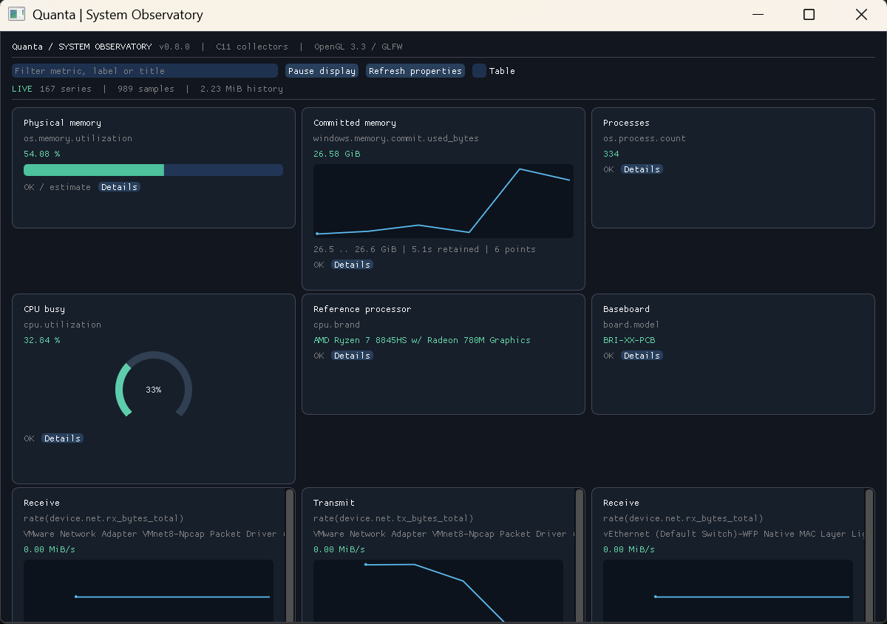
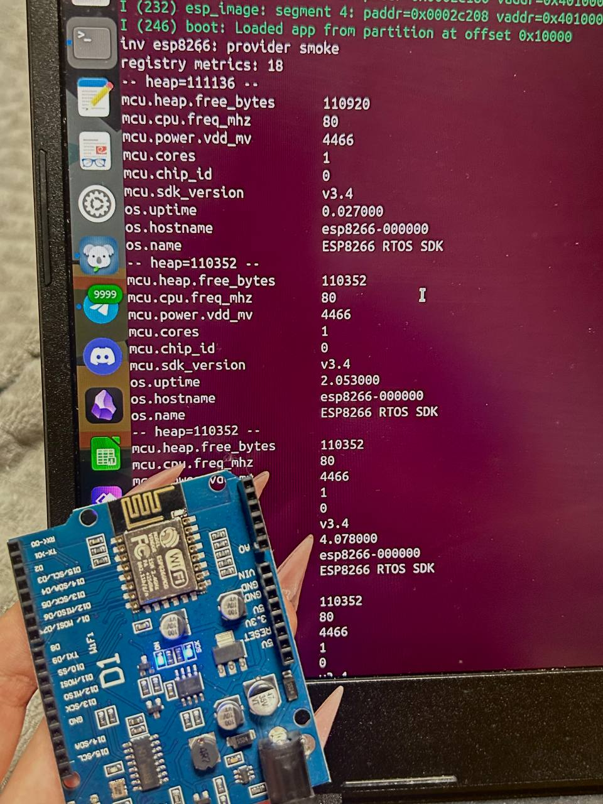
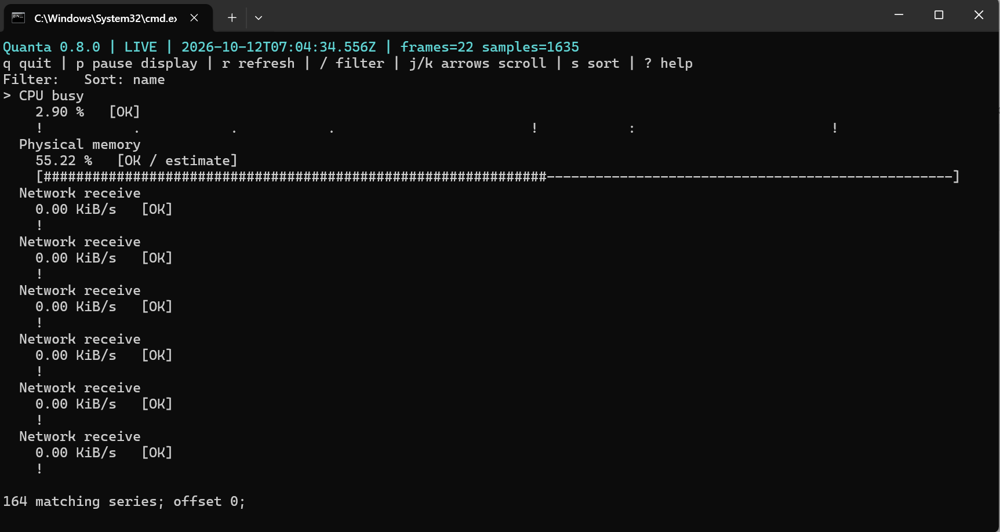

# Quanta 0.8.0

На связи
[Мастерская системного программирования ИТМО](https://t.me/itmosysint)

<p align="center"></p>

**Сбор, обработка и отображение аппаратных и системных метрик на C**

**Репозиторий:** https://github.com/sit-itmo/Quanta

## Цель и архитектура

Цель в создании платформы для сбора метрик и информации о системе. Основой является ядро на языке С которое можно компилировать где угодно (хоть а утюге). С момощью ядра quanta регистрируются все возможные в системе метрики (серийники, счетчики, темпиратура, ...), и с помощью программы quanta собирать эти метрики в любой момент по одному, в фафлы MD/CSV/TXT, отображать с помощью GUI/TUI, а так же делать сложные запросы нужных конфигураций с помощью встроенного языка запросов.

### Базовые положения
* Query, каталог, планировщик и история отделены от способов измерения и отображения.
* Одно имя метрики — один способ получения. 
* HAL предоставляет аппаратные примитивы; сборщики ОС/CPUID/SDK
могут его не использовать. 
* Минимальный контракт исполнения описан в [include/quanta/osal.h](include/quanta/osal.h). 
* Публичные заголовки находятся в `include/quanta/`.
* Комментарии собственных исходников, заголовки файлов, тесты и скрипты — **на английском**.
* Документация Quanta в Markdown, включая описания метрик, — **на русском**.
* Каждая метрика снабжается не только способом получения (callback) но и описанием и типом.
* GUI по умолчанию: **Dear ImGui + GLFW + OpenGL 3.3**.
* Сборка на базе CMake

```text
app → frontend (file / TUI / ImGui) → core (query / catalog / scheduler / history / live)
                                      ↓
                            sensors (metric callbacks)
                              ↙                 ↘
                      primitive HAL       native OS / CPUID / SDK
```

[Архитектура](docs/ARCHITECTURE.md) · [Понятия и чтение кода](docs/CODE_GUIDE.md) ·
[Query](docs/QUERY.md) · [HAL](docs/HAL.md) · [Добавление метрик](docs/METRICS.md).
[Исходный дизайн](docs/Quanta_Design.md) и [схема](docs/assets/architecture-original.jpg)
сохранены как историческая основа: providers и несколько программ в них уже неактуальны.

## Зачем это всё?

Прграмма quanta это открытый проект который позволяет изучить различные низкоуровневые метрики системы, уметь удобно их отображать и анализировать. Удобный query и способы отображения позволяют использовать программу в системах автоматизации. Цель получить больше информации о системе, понять ее характеристики и разобраться какие идентификаторы в ней есть.

Приглашаем всех поучаствовать в проекте и добавить свои метрики.

## Сборка в Linux / Ubuntu

```bash
sudo apt-get update
sudo apt-get install --no-install-recommends build-essential cmake libglfw3-dev libx11-dev

cmake -S . -B build/linux
cmake --build build/linux --parallel
ctest --test-dir build/linux --output-on-failure

./build/linux/bin/quanta --list-modes
./build/linux/bin/quanta examples/queries/04-dashboard-gui.q
```

При отсутствии файлов разработки OpenGL CMake выдаёт сообщение с указанием пакета
`libgl-dev`. Для запуска окна нужен графический сеанс и поддержка OpenGL 3.3; в WSL —
работающий WSLg/X-сервер. Дополнительные проверки используют Python/Xvfb,
когда они установлены. Сама конфигурация и сборка ничего из сети не скачивают.

## Сборка в Windows

Нужны Visual Studio (рекоммендуется 2022) с компонентом Desktop development with C++ и Windows SDK.
**[Скачать CMake для Windows](https://cmake.org/download/)** — выбрать Windows x64 Installer
и добавить CMake в PATH. Минимальная версия проекта — CMake 3.21.

```powershell
cmake -S . -B build/windows
cmake --build build/windows --config Release --parallel
ctest --test-dir build/windows -C Release --output-on-failure

.\build\windows\bin\Release\quanta.exe --list-modes
.\build\windows\bin\Release\quanta.exe examples/queries/windows/04-dashboard-gui.q
```

## Другие варианты сборки

По умолчанию GUI работает на базе ImGUI + GLFW + OpenGL и на Windows и на Linux
Однако мы планируем запуск quanta и на микроконтроллерах (уже поддерживается ESP8266), для этих случаев есть реализация ImGUI на базе framebuffer (**CPU/framebuffer**, без GLFW и OpenGL):
Эту версию можно протестировать и в Windows и в Linux. Для этого собрать:

```bash
cmake -S . -B build/framebuffer -DQUANTA_GUI_BACKEND=FRAMEBUFFER
cmake --build build/framebuffer --parallel
ctest --test-dir build/framebuffer --output-on-failure
```

На Windows к сборке и CTest добавить `--config Release` и `-C Release`.
Есть также профили `linux-framebuffer` и `windows-framebuffer`.
ImGui рисует в RGB32-буфер; показ выполняется через X11/Xlib на Linux и Win32/GDI
на Windows. Для Linux достаточно `build-essential cmake libx11-dev`.
Это не готовый драйвер `/dev/fb0`, DRM/KMS или UEFI: [границы переноса](vendor/PORTABLE_GUI.md).

**Без GUI**, со всеми метриками текущей ОС и TUI:

```bash
cmake --preset linux-no-gui
cmake --build --preset linux-no-gui --parallel
ctest --preset linux-no-gui --output-on-failure
```

Для Windows использовать `windows-no-gui`. Без профиля:
`cmake -S . -B build/no-gui -DQUANTA_WITH_GUI=OFF`.
Этот вариант не требует C++ и графических библиотек.

## Режимы работы

Примеры запусков:

```bash
quanta get os.uptime --format value
quanta get os.uptime --format csv
quanta dashboard.q --tui
quanta dashboard.q --gui
quanta dashboard.q --cli --format table --hal none
quanta --list-hals
quanta describe os.memory.available_bytes
```

CLI имеет приоритет над query. Графический backend выбирается **при сборке**, а режим
`--gui` — при запуске. Недоступный режим возвращает явную ошибку.

## Структура

Структура кода проекта:

```text
include/quanta/               Публичный API, osal.h, hal.h, metric_def.h
core/                        Query, каталог, планировщик, значения, история
hal/ + osal/                 Аппаратные примитивы и минимальная среда исполнения
sensors/common/              Общие алгоритмы и метрики через HAL
sensors/os/{linux,windows}/   Реализации для конкретной ОС
sensors/arch/x86/             CPUID
sensors/platform/esp8266/     Метрики MCU/SDK
metrics/                     Объявления .def с типовыми обёртками
frontends/                   Текстовый вывод, TUI, общий GUI и графические backend
app/                         Единственная утилита quanta
firmware/esp8266/             SDK-компонент и serial-приложение
vendor/                      Исходники зависимостей и сведения об их происхождении
```

Все девять MCU-метрик и отдельная сборка ESP8266 сохранены:
[инструкция для SDK/платы](docs/ESP8266.md).

## Актуальные задачи (Roadmap)

[Тестирование и ограничения проверки](docs/TESTING.md) · [Полная сборка](docs/BUILD.md) ·
[TODO](docs/TODO.md).

- [ ] Добавить поддержку RW.sys в качестве HAL для windows.
- [ ] Добавить метрики по x86 платформам на базе HAL.

## Команда
- Участники сообщества: https://t.me/itmosysint
- Координатор: Алексей Никольский — https://t.me/ebfecode

Авторы (по алфавиту):
- София @pactiwka999

## Полезные ссылки
- https://github.com/ocornut/imgui
- https://github.com/glfw/glfw

## Скрины
| Windows GUI | Hardware | TUI |
|:---:|:---:|:---:|
|  |  |  |
